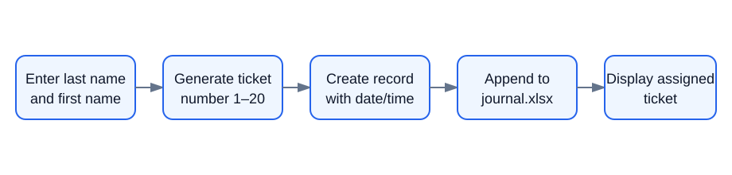
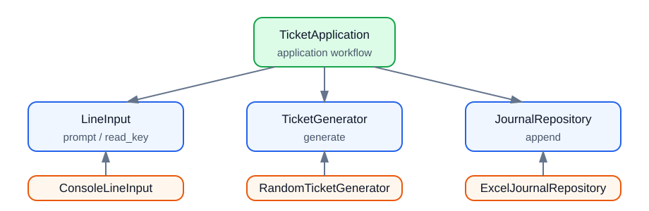

# Exam Ticket Generator

A Windows console application that asks for a student's last name and first name, assigns a random ticket number from 1 to 20, and immediately adds the record to `journal.xlsx` next to the application.

## Workflow



1. Start the application.
2. Enter the last name.
3. Enter the first name.
4. The application generates a random ticket number.
5. The record is saved in `journal.xlsx`.
6. The assigned ticket number is displayed.
7. Press **ESC** at the beginning of either input field to exit.

## Requirements

- Python 3
- PowerShell
- Internet access during initial package installation

## Installation

Open PowerShell in the project directory and run once:

```powershell
.\setup.ps1
```

This creates the `.venv` environment and installs `openpyxl`.

## Running the Application

```powershell
.\run.ps1
```

If Python is not installed, download it from [python.org](https://www.python.org/downloads/windows/) and enable **Add python.exe to PATH**. Then reopen PowerShell and run `.\setup.ps1`.

## Excel Journal

The application creates `journal.xlsx` automatically on the first saved record. The following columns are used:

| Last name | First name | Ticket number | Date and time |
|---|---|---:|---|

On later runs, new rows are appended to the existing worksheet. The application does not overwrite previous records.

If Excel has opened `journal.xlsx`, close the file and press **Enter** to retry. Press **ESC** to exit without saving the current record.

## Input Behavior

- Empty input is rejected and requested again.
- Backspace removes the last entered character.
- **ESC** exits at the beginning of either input field.
- Ticket numbers are in the range **1–20**.
- The workbook is saved after each student record.

## SOLID Architecture



The implementation uses small abstractions and separates responsibilities:

- **SRP**: input handling, ticket generation, Excel storage, and application flow are separate.
- **OCP**: interfaces allow input, storage, or ticket generation implementations to be replaced without changing `TicketApplication`.
- **LSP**: `RandomTicketGenerator`, `ExcelJournalRepository`, and `ConsoleLineInput` can substitute their abstract base classes.
- **ISP**: each abstraction exposes only the operations it requires.
- **DIP**: `TicketApplication` depends on abstractions, not concrete openpyxl or console implementations.

## Project Files

- `main.py` — application and SOLID components
- `journal.xlsx` — generated student journal
- `run.ps1` — application launcher
- `setup.ps1` — virtual environment and dependency setup
- `requirements.txt` — Python dependencies
